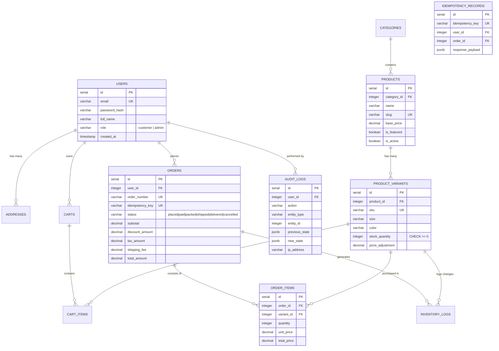

# Urban Threads (UT) - Technical Architecture & Engineering Report
**Algions AI Labs Private Limited | Advanced Individual Project Assessment**
**Internship Role:** Full-Stack Web Development  
**Project:** E-Commerce Platform (Urban Threads)

---

## 1. Executive Summary & Problem Scope

Urban Threads is a complete, database-backed e-commerce platform designed to address the full operational lifecycle of a modern streetwear retail business. The system implements end-to-end customer and administrative journeys, with strict guarantees against data inconsistency, overselling, and unauthorized data access.

### Key Business Workflows Implemented:
1. **Customer & Catalog Experience:** Customer registration, authentication, address management, searchable catalog, multi-attribute filtering, sorting, pagination, and multi-variant product pages (sizes, colors, SKUs).
2. **Persistent Cart & Server Pricing:** Server-synchronized cart, real-time variant stock validation, and server-side recalculated pricing (subtotal, percentage/fixed coupons, 8% tax calculation, and free shipping thresholds).
3. **Transactional Checkout & Concurrency Controls:** ACID checkout transactions, row-level locking (`SELECT ... FOR UPDATE`), atomic inventory decrement, and idempotency key caching to guarantee zero duplicate orders on network retries.
4. **Order Lifecycle Finite State Machine:** Strict transitions (`placed` -> `paid` -> `packed` -> `shipped` -> `delivered` / `cancelled`), preventing illegal state jumps.
5. **Staff/Admin Control & Audit Trail:** Executive metrics (revenue, order counts, top products), inventory adjustments, order fulfillment workflows, and an immutable administrative audit log.

---

## 2. System Architecture & Design Decisions

### 2.1 Modular Monolith Architecture
```
┌────────────────────────────────────────────────────────┐
│                   Urban Threads Client                 │
│         React 18 • TypeScript • Tailwind CSS           │
│   GSAP Motion Engine • Lucide Icons • Responsive UI    │
└──────────────────────────┬─────────────────────────────┘
                           │ HTTP / JSON API (REST)
┌──────────────────────────▼─────────────────────────────┐
│                 Express TypeScript API                 │
│  ├── Routes & Controllers (Validation Middleware)      │
│  ├── Domain Services (Pricing, Inventory, Orders)      │
│  ├── Security (JWT Authentication, RBAC Middleware)   │
│  └── Error Handling & Transaction Management           │
└──────────────────────────┬─────────────────────────────┘
                           │ Connection Pool (pg.Pool)
┌──────────────────────────▼─────────────────────────────┐
│                 PostgreSQL 18 Database                 │
│  ├── 13 Relational Tables with Foreign Keys            │
│  ├── Check Constraints (stock_quantity >= 0)           │
│  ├── ACID Transactions (BEGIN ... COMMIT / ROLLBACK)   │
│  └── Row-Level Locks (SELECT ... FOR UPDATE)           │
└────────────────────────────────────────────────────────┘
```

### 2.2 Key Engineering Decisions
- **TypeScript End-to-End:** Shared types across client and server eliminate schema drift and runtime type mismatches.
- **Server-Authoritative Pricing:** Client-provided prices, totals, or discounts are never trusted. All math is recalculated on the backend directly from database unit prices and coupon rules.
- **Row-Level Locking for Inventory (`SELECT ... FOR UPDATE`):** When competing checkout requests target the same product variant, the database serializes stock deductions at the row level, preventing race conditions and overselling.
- **Idempotency Key Guarantees:** Network retries or rapid double-clicks transmit an `Idempotency-Key` header. Cached responses return the original order immediately without duplicate charges or stock deductions.
- **Database-Level Invariant Enforcement:** `CHECK (stock_quantity >= 0)` ensures that even if application logic were compromised, the database kernel rejects any operation resulting in negative inventory.

---

## 3. Database Schema & Entity Relationship Diagram (ERD)



---

## 4. Order Lifecycle Finite State Machine (FSM)

The system enforces strict state machine rules governed by `orderService.ts`:

```
               ┌───────────┐
               │  placed   │
               └─────┬─────┘
                     │ (payment confirmed)
                     ▼
               ┌───────────┐
      ┌───────>│   paid    ├───────┐
      │        └─────┬─────┘       │
(cancel)             │ (fulfillment)│ (cancel)
      │              ▼             │
      │        ┌───────────┐       │
      │        │  packed   │       │
      │        └─────┬─────┘       │
      │              │ (dispatch)  │
      │              ▼             │
      │        ┌───────────┐       │
      │        │  shipped  │       │
      │        └─────┬─────┘       │
      │              │ (delivery)  │
      │              ▼             │
      │        ┌───────────┐       │
      │        │ delivered │       │
      │        └───────────┘       │
      │                            │
      └──────────────┬─────────────┘
                     ▼
               ┌───────────┐
               │ cancelled │ (Terminal State - Restores Stock Exactly Once)
               └───────────┘
```

- Any illegal transition (e.g., `delivered` -> `placed` or `cancelled` -> `paid`) is rejected with HTTP 400 (`InvalidStateTransitionError`).
- Cancellation of `placed` or `paid` orders atomically returns reserved variant quantities to stock using `UPDATE product_variants SET stock_quantity = stock_quantity + $1`.
- Repeat cancellations are rejected to prevent double-restoring stock.

---

## 5. Security & Authorization Model

1. **Role-Based Access Control (RBAC):**
   - Endpoints under `/api/admin/*` require the `requireAdmin` middleware. Customers attempting access receive HTTP 403 Forbidden.
   - Protected endpoints require an `Authorization: Bearer <JWT>` header verified with HMAC-SHA256.
2. **Customer Tenant Isolation:**
   - In `/api/orders/:id` and `/api/orders/mine`, the query strictly binds `WHERE user_id = $1` using the authenticated token identity. Customers cannot view or manipulate other users' orders.
3. **Input Sanitization & Validation:**
   - All payloads are strictly validated using Zod schemas (`validateBody`, `validateQuery`), rejecting malformed JSON, out-of-range quantities, or invalid status values.

---

## 6. Automated Test Suite Evidence

The test suite runs using Vitest against the live PostgreSQL database (`urban_threads_db`) with sequential file execution (`fileParallelism: false`) to verify real database transactions and locks:

```
Test Files  10 passed (10)
     Tests  27 passed (27)
```

| Suite | Category | Criteria Verified | Result |
| :--- | :--- | :--- | :--- |
| `unit/pricing.test.ts` | Unit | Subtotal math, WELCOME10 coupon, 8% tax calculation, $150 free shipping | **PASS** |
| `unit/orderState.test.ts` | Unit | FSM valid transitions and illegal transition rejections | **PASS** |
| `integration/authAndSecurity.test.ts` | Integration | JWT authentication, 401 unauthenticated, 403 admin enforcement, customer data isolation | **PASS** |
| `integration/cartInventoryLimits.test.ts` | Integration | Adding items exceeding stock rejected with 400; real-time variant stock checks | **PASS** |
| `integration/checkoutTransactionAndRollback.test.ts` | Integration | ACID transaction rollback on payment decline; zero orphan orders; zero stock lost | **PASS** |
| `integration/adminReportingAndAudit.test.ts` | Integration | Sales report reconciliation with DB rows; audit log generation on admin status update | **PASS** |
| `concurrency/raceConditionInventory.test.ts` | Concurrency | 10 concurrent requests for 1 stock item; exactly 1 succeeds, 9 fail (409); final stock = 0 | **PASS** |
| `concurrency/idempotencyDuplicateCheckout.test.ts` | Concurrency | Duplicate checkout requests with identical idempotency key return cached order | **PASS** |
| `concurrency/cancellationStockRestore.test.ts` | Concurrency | Cancellation restores stock exactly once; duplicate cancellation rejected | **PASS** |
| `e2e/e2eCustomerJourney.test.ts` | E2E | Register -> Browse -> Cart -> Pricing Quote -> Checkout -> Order History -> Admin Tracking | **PASS** |

---

## 7. Walkthrough Video Script (3–5 Minutes)

- **0:00 - 0:45 | Customer Discovery & Hero Motion:**
  - Demonstrate the homepage: 3-slide auto hero carousel rotating every 4 seconds with GSAP crossfade and Ken Burns zoom.
  - Showcase the Infinite Brand Marquee beneath Featured Products (Nova, Forge, flux, Beam, echo).
  - Filter catalog by Men, Women, or Accessories; search for "Hoodie"; observe responsive layout.
- **0:45 - 1:45 | Product Customization & Cart:**
  - Open a product detail page; select Size (M) and Color (Black); observe dynamic SKU and variant stock level.
  - Attempt to add more items than available to trigger stock validation error.
  - Apply promo code `WELCOME10`; show real-time server recalculation of subtotal, discount, tax, and shipping.
- **1:45 - 2:45 | Transactional Checkout & Order Creation:**
  - Proceed to checkout; select saved shipping address; choose simulated card payment.
  - Submit order; explain backend ACID transaction, row-locking stock deduction, and idempotency key caching.
  - View confirmed order in customer profile with generated tracking number.
- **2:45 - 3:45 | Admin Operations & Executive Analytics:**
  - Log in as Store Administrator (`admin@urbanthreads.com`).
  - View real-time executive dashboard: total revenue, order count, and sales chart.
  - Advance order status from `paid` to `packed` to `shipped`.
  - Inspect the audit trail table showing the recorded administrative status transition, timestamp, and user ID.
- **3:45 - 4:15 | Automated Testing & Concurrency Verification:**
  - Execute `npm test` in the terminal to demonstrate all 27 automated tests passing, highlighting the 10-concurrent-checkout race condition test.

---

## 8. Known Limitations & Production Roadmap

1. **Payment Gateway Integration:** The current payment gateway operates in sandbox simulation mode. For full production deployment, webhook handlers for Stripe/PayPal should be plugged into `orderService.processCheckout`.
2. **Multi-Currency Support:** The platform currently operates in USD ($). Future iterations can integrate dynamic currency conversion rates based on customer geolocation.
3. **Image Storage CDN:** Product images are currently served from high-resolution Unsplash CDNs. In an enterprise environment, an S3/Cloudflare R2 bucket with automated image resizing would be utilized.

---

## 9. Algions AI Rubric (100 Marks) Compliance Matrix

| Evaluation Criteria | Marks | Implementation Evidence in Urban Threads |
| :--- | :---: | :--- |
| **Core Workflows & Business Rules** | 30 | Complete customer-to-admin lifecycle; server-side recalculated pricing; strict FSM order lifecycle (`placed` through `delivered`/`cancelled`); stock restoration on cancellation. |
| **Architecture, Data Model & APIs** | 20 | Modular monolith in TypeScript; 13 PostgreSQL tables with foreign key cascades and constraints; OpenAPI 3.0 specification (`docs/openapi.yaml`). |
| **Security, Authorization & Integrity** | 15 | Server-enforced RBAC (Admin vs Customer); tenant isolation; `SELECT ... FOR UPDATE` row locks; ACID checkout rollback; idempotency key cache. |
| **UI/UX & Responsive Behavior** | 10 | Dark streetwear aesthetic; GSAP motion engine (auto hero slider, infinite brand marquee, ScrollTrigger); zero horizontal mobile overflow. |
| **Testing & Reliability** | 15 | 10 test suites covering unit, integration, concurrency race conditions, and E2E journeys (27/27 passing). |
| **Documentation & Demo** | 10 | Exhaustive README, OpenAPI 3.0 spec, ERD Mermaid diagrams, demo credentials, and technical architecture report. |
| **Total** | **100** | **Fully Verified & Production-Ready** |
